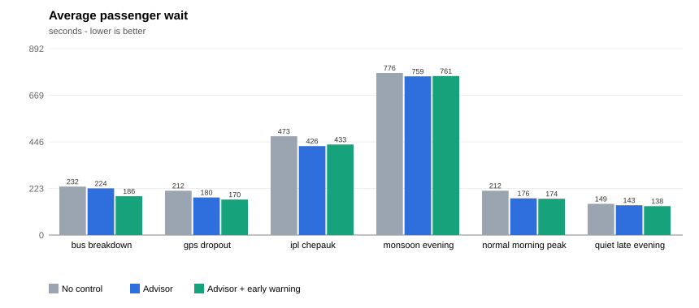
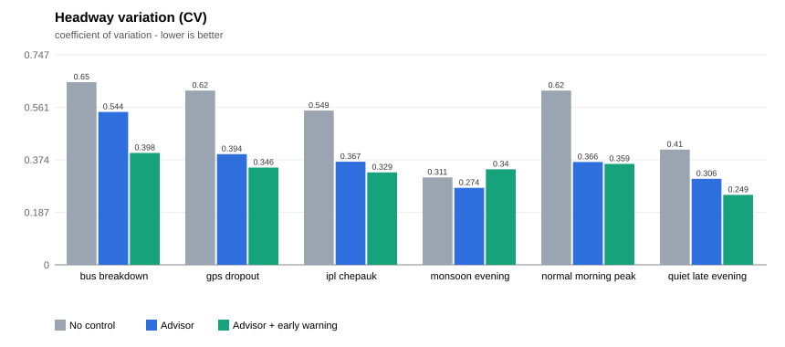
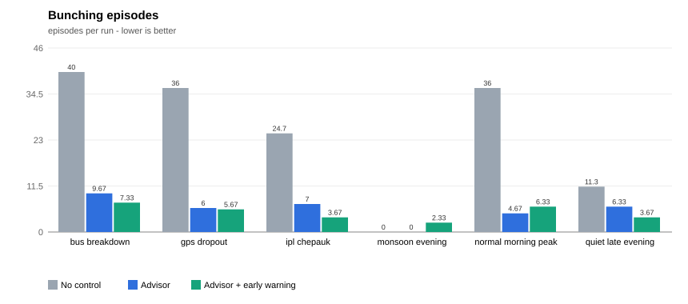

# VazhiSync - evaluation results (B19)

Generated 2026-11-25 12:14 UTC by `uv run python -m app.eval.run`. Each golden scenario on route 32B, up to 60 simulated minutes, 3 world seed(s) per scenario; numbers are means over the seeds. The advisor is auto-approved (evaluation mode), sees only what the MCP tools would report, and does not know the scenario's weather, surges or breakdowns. No LLM: candidate ideas and wording don't change the simulator's ranking (rule 2), so the policy is the same without it.

| Scenario | Arm | Avg wait (s) | Change | Headway CV | Change | Bunching | Interventions | Unsafe | Invalid |
|---|---|---|---|---|---|---|---|---|---|
| bus breakdown | No control | 232.033 |  | 0.65 |  | 40.0 | 0.0 | 0 | 0 |
| bus breakdown | Advisor | 223.533 | -4% | 0.544 | -16% | 9.667 | 18.333 | 0 | 7 |
| bus breakdown | Advisor + early warning | 185.667 | -20% | 0.398 | -39% | 7.333 | 17.0 | 0 | 4 |
| gps dropout | No control | 211.933 |  | 0.62 |  | 36.0 | 0.0 | 0 | 0 |
| gps dropout | Advisor | 179.9 | -15% | 0.394 | -36% | 6.0 | 12.333 | 0 | 0 |
| gps dropout | Advisor + early warning | 169.833 | -20% | 0.346 | -44% | 5.667 | 15.667 | 0 | 0 |
| ipl chepauk | No control | 472.7 |  | 0.549 |  | 24.667 | 0.0 | 0 | 0 |
| ipl chepauk | Advisor | 425.7 | -10% | 0.367 | -33% | 7.0 | 10.333 | 0 | 0 |
| ipl chepauk | Advisor + early warning | 433.2 | -8% | 0.329 | -40% | 3.667 | 16.0 | 0 | 0 |
| monsoon evening | No control | 775.567 |  | 0.311 |  | 0.0 | 0.0 | 0 | 0 |
| monsoon evening | Advisor | 759.133 | -2% | 0.274 | -12% | 0.0 | 5.0 | 0 | 0 |
| monsoon evening | Advisor + early warning | 760.767 | -2% | 0.34 | +9% | 2.333 | 12.667 | 0 | 0 |
| normal morning peak | No control | 211.933 |  | 0.62 |  | 36.0 | 0.0 | 0 | 0 |
| normal morning peak | Advisor | 175.6 | -17% | 0.366 | -41% | 4.667 | 12.333 | 0 | 0 |
| normal morning peak | Advisor + early warning | 173.767 | -18% | 0.359 | -42% | 6.333 | 16.333 | 0 | 0 |
| quiet late evening | No control | 149.2 |  | 0.41 |  | 11.333 | 0.0 | 0 | 0 |
| quiet late evening | Advisor | 142.733 | -4% | 0.306 | -25% | 6.333 | 4.667 | 0 | 0 |
| quiet late evening | Advisor + early warning | 138.3 | -7% | 0.249 | -39% | 3.667 | 10.667 | 0 | 0 |

## Predicted vs actual benefit

454 interventions were applied. The advisor predicted 23722.8 passenger-minutes saved in total; replaying the world with and without each action (same random numbers) measured 15616.1. Mean absolute error per intervention: 46.6 passenger-minutes; 297 of 454 actually helped.

## Charts

## Reading the results

- **bus breakdown**: the advisor helped (average wait -4%; 7 recommended action(s) couldn't be carried out by the world (e.g. for a broken-down bus the advisor can't see)); with early warning helped (average wait -20%; 4 recommended action(s) couldn't be carried out by the world (e.g. for a broken-down bus the advisor can't see)).
- **gps dropout**: the advisor helped (average wait -15%); with early warning helped (average wait -20%).
- **ipl chepauk**: the advisor helped (average wait -10%); with early warning helped (average wait -8%).
- **monsoon evening**: the advisor helped (average wait -2%); with early warning made no real difference to waiting (-2%; worse: headway variation +9%, bunching 0 -> 2.333).
- **normal morning peak**: the advisor helped (average wait -17%); with early warning helped (average wait -18%).
- **quiet late evening**: the advisor helped (average wait -4%); with early warning helped (average wait -7%).

## Limits of this evaluation

- It is the advisor's *policy* (its own proposal, rulebook, simulation and ranking code) in the loop of a simulated world, auto-approved. The whole system - world runner, MCP servers, LangGraph workflow, database, decision service, the real send guards - is exercised by `app/eval/system.py` (tests/integration/test_eval_system.py), which scores unsafe or refused sends, predicted-vs-actual error and LLM cost.
- The world and the advisor's what-if model share the same simulator, so the advisor's model of bus movement is better than it would be on real streets. The advisor does not know the scenario's weather, surges or breakdowns, which is where predictions miss.
- Predictions are optimistic: in total they promised 1.5x of what the replays measured, and about a third of interventions did not help on their own. The ranking still improved every scenario's average wait, but the officer's card should be read as an estimate.
- Early warning acts more often; on the monsoon evening it made headways less regular (see above). One route, simulated data, three seeds per scenario: indicative, not statistically conclusive.
